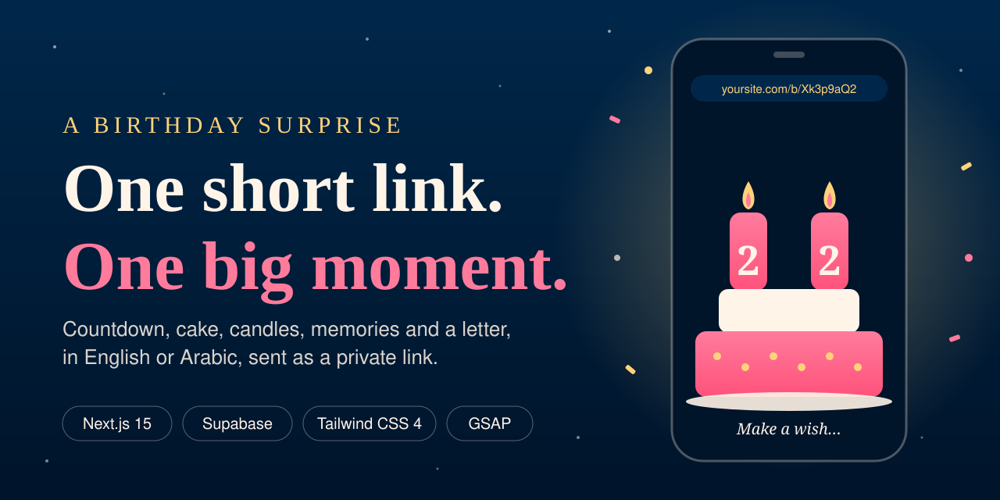
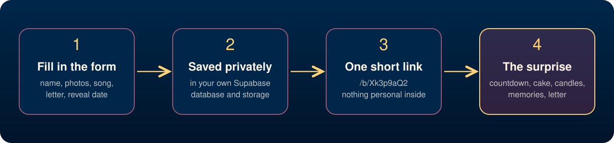

<p align="center">
  
</p>

<h3 align="center">A birthday gift you send as a link, and they will remember.</h3>

<p align="center">
  
  
  
  
  
  
</p>

---

## The idea

A message or a card is nice. A moment is better.

**Birthday Surprise** turns a few photos, a song and a heartfelt letter into a small interactive experience that lives behind one short, private link:

```
yoursite.com/b/Xk3p9aQ2
```

Send it by chat, text or email. The person opens it and the surprise begins.

## What they experience

1. **A countdown.** The page waits, blurred, until the exact moment you choose.
2. **A cake.** They tap to light the candles, showing their real age (any age from 1 to 999), while their song starts to play.
3. **A wish.** They blow out the candles and the screen fills with confetti.
4. **Your memories.** Your photos and captions glide past in a scrolling timeline.
5. **Your letter.** It finishes with a letter in your own words, on a soft paper background.

It works on phones, tablets and computers. It speaks **English and Arabic**. Leave language and direction on *Automatic* and the page follows what you wrote (even a page that mixes both), or choose the language and the direction yourself.

## What makes it personal

| You choose | They see |
| --- | --- |
| Their name | The whole page greets them by name |
| Their age | Number candles that match it (a "2" and a "2" for 22) |
| A song | Music that starts when they light the candles and fades after the wish |
| Up to 20 photos with captions | A scrolling memory timeline |
| A letter (up to 7,000 characters) | A private note that closes the experience, in an envelope that opens |
| Language: English or Arabic | All the page's own wording (countdown, buttons, greeting) in that language |
| Direction: left-to-right or right-to-left | Text and layout flow the way you choose |
| A reveal date | A live countdown until the surprise opens |

You create all of this from a simple form. No design or coding skills needed. Fill it in, press one button, and copy your link.

## Private by design

A birthday page holds personal things, so privacy comes first.

- **Nothing personal in the link.** No name, no letter, no photo addresses. Only a short random code that nobody can guess.
- **Only people with the link can see it.** Pages are hidden from search engines.
- **Your data stays yours.** It is stored in your own database, which cannot be read from outside.
- **Only you can create pages.** The form is protected by a private admin key.

## Why it stands out

- **Feels like a gift, not a form.** Smooth animation, a real cake, real candles.
- **Short links.** They stay short no matter how long your letter is.
- **Bilingual from day one.** Right-to-left layouts and Arabic typography are built in, and the creator can pick language and direction or leave it automatic.
- **Considerate.** Visitors who have reduced motion turned on get calmer animations. A broken song file never breaks the page.
- **Always works.** Links sent before an update keep working.

---

## For engineers and hiring managers

This project is small on purpose, so the engineering is easy to read.

<p align="center">
  
</p>

**What I built and why**

| Area | What it does |
| --- | --- |
| **Short, private links** | Pages are stored as rows in Supabase Postgres and served at `/b/<id>`. IDs are 8 random characters from a cryptographic source (about 2 × 10¹⁴ combinations), with automatic retry on collision. Replaced an earlier design that packed everything into a very long URL. |
| **Database security** | Row Level Security is on with no public policies, so the public key can't read or write anything. Only the server, using the service-role key, touches the data, and that key never reaches the browser. |
| **Input safety** | Everything is cleaned on the way in and again on the way out: length limits, an allow-list for link types (only `https`, `http` or local paths), age bounds, and a request size cap. |
| **Safe uploads** | Allow-listed file types and sizes, server-chosen random file names, the content type is never taken from the browser, and SVG uploads are refused. Files go to Supabase Storage, so they work on serverless hosting. |
| **Admin protection** | A secret key checked with a constant-time comparison. A public server refuses to create pages at all unless the key is set. |
| **Backwards compatibility** | The older long-URL formats still open, so nothing already sent breaks. |
| **Internationalisation** | Arabic and Latin letters are counted per text block to set `lang` and `dir` automatically, and the creator can override the language and the direction independently. Layout uses logical CSS properties, and animations flip in right-to-left. |
| **Motion and accessibility** | GSAP timelines and scroll animations, with `prefers-reduced-motion` respected and scrolling gated behind the candle moment. |
| **Metadata** | Per-page titles and link previews, set on the server with one cached database read per request. |

**Stack:** Next.js 15 (App Router, server components, route handlers), TypeScript, Supabase (Postgres and Storage), Tailwind CSS 4, GSAP.

**Code worth a look**

- `lib/shareStore.ts`: saving and loading pages, ID generation
- `lib/share.ts`: validation and cleaning of untrusted input
- `app/api/share/route.ts` and `app/api/upload/route.ts`: protected endpoints
- `app/b/[id]/page.tsx`: the short-link page and its metadata
- `lib/direction.ts` and `lib/i18n.ts`: automatic language and direction
- `supabase/schema.sql`: the table, security rules and storage bucket

---

## Want one made for you?

Whether it's a partner, a parent, a friend or a whole team, I can set up a personal Birthday Surprise and hand you a link that's ready to send.

Open an issue on this repository or get in touch through my profile.

<p align="center"><sub>Made with love. 💛</sub></p>
